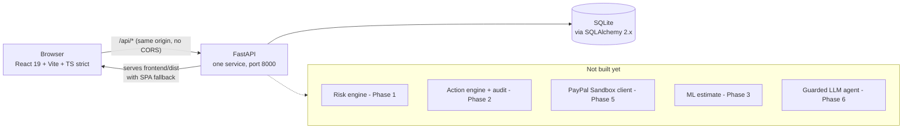

# MerchantShield AI

**Stops PayPal disputes before they happen, and helps small merchants answer
the ones that do.**

Sandbox-first. Every record on screen is labelled with where its data actually
came from. Nothing here touches real money.

> **Current status: Phase 0 (walking skeleton), re-run 2026-11-07.**
> A FastAPI backend with two endpoints, one seeded order, a React page that
> renders it with a provenance chip, **86 passing backend tests**, a mutation
> checker that **caught 3/3** phase-0 mutations, and **6 Playwright tests that
> passed in a real headless Chromium** (1500x900 and 390x844). The risk engine,
> action engine, PayPal integration and AI layers are **not built yet** - see
> the roadmap below. The sandbox browser run used a substituted Chromium build;
> the pinned one then passed in GitHub Actions, which triggered for the first
> time once the workflow moved to the repository root. See "Verification
> status" for exactly what each of those does and does not prove.

---

## Honesty table

This project's core claim is that it never overstates what it knows. Three
labels, shown on every record:

| Label | Meaning | Can it be a real PayPal response? |
| --- | --- | --- |
| `PAYPAL_SANDBOX` | An actual response from the PayPal **Sandbox** REST API | Yes - Sandbox only, never production |
| `SIMULATED` | Behaviour generated locally by this app. Nothing external was contacted | No |
| `MOCK` | A mock adapter or canned test response standing in for PayPal | No |

`is_demo` and `demo_run_id` are tracked **separately** from `source`. A row
created from a real Sandbox response is `is_demo=false` even during a demo,
and "Reset Demo" must never delete it.

### What Phase 0 does *not* do

No PayPal call has been made. There is no PayPal client code yet. There is no
risk scoring, no action engine, no AI. The single order you see is
`SIMULATED` - this app invented it.

---
## Quick start (Windows 11, PowerShell)

Works in **Windows PowerShell 5.1** (the blue one, built in) and in
**PowerShell 7** (`pwsh`). Every command below is a *separate line* on
purpose:

- `&&` and `||` do **not** work in Windows PowerShell 5.1. Run one line at a
  time, and check each one worked before continuing.
- Environment variables are `$env:NAME = "value"`, never `export NAME=value`.
  They last only for that one window.
- `python` means the virtualenv's Python *after* you activate it. Before that,
  use `py -3.11`.

### 0. Check your versions first

Three of the four most common failures are version problems, so check before
you install anything.

```powershell
py -3.11 --version      # expect: Python 3.11.x
node --version          # expect: v24.x.x
npm --version
git --version
```

| If you see | What it means | What to do |
| --- | --- | --- |
| `py` is not recognised | The Python launcher is missing | Install Python 3.11 from python.org and tick **Add python.exe to PATH** |
| `Python 3.12`/`3.13` from `py -3.11` | 3.11 is not installed | Install 3.11 specifically. The pins in `backend/requirements.txt` are tested against 3.11 only |
| `node --version` is not `v24.x` | Wrong Node major | Install Node 24 (`.nvmrc` says `24`). Vite 8 needs `>= 22.12`, so Node 20 will fail |
| `npm ci` prints `EBADENGINE` | Node is older than a package allows | This is the same wrong-major problem. Fix Node rather than ignoring the warning |

### 1. Choose a short folder path

Clone or extract into a **short path with no spaces and no OneDrive**:

```powershell
C:\dev\merchantshield-test
```

Why: Windows still has a 260-character path limit in many tools, and
`node_modules` plus Playwright's cache nest deeply. OneDrive adds file locking
and sync delays that look like random test failures.

If your path *does* contain a space (for example `C:\Users\Test User\...`),
that is supported — the test harness quotes interpreter paths for you — but
always wrap paths in double quotes when you type them yourself.

### 2. Backend

```powershell
cd C:\dev\merchantshield-test

py -3.11 -m venv .venv
.\.venv\Scripts\Activate.ps1
python -m pip install --upgrade pip
python -m pip install -r backend\requirements.txt
```

> **If PowerShell refuses to run `Activate.ps1`** with
> *"running scripts is disabled on this system"*:
>
> ```powershell
> Set-ExecutionPolicy -Scope Process -ExecutionPolicy Bypass
> ```
>
> `-Scope Process` means **this window only**. It is not permanent, it does
> not change your machine's settings, and it is gone when you close the
> window. Do not use `-Scope LocalMachine`.
>
> You can also skip activation entirely: use `.\.venv\Scripts\python.exe`
> instead of `python` everywhere.

### 3. Configuration

```powershell
# Either copy the example file (read from the project root, from any cwd)...
Copy-Item .env.example .env

# ...or set the variables in this shell. Shell values WIN over .env.
$env:DEMO_MODE = "true"
$env:DATABASE_URL = "sqlite:///./merchantshield.db"
$env:PAYPAL_MODE = "mock"
```

### 4. Backend tests

```powershell
cd backend
python -m pytest -v
cd ..
```

### 5. Frontend

```powershell
cd frontend
npm ci
npx playwright install chromium
npm run build
cd ..
```

`npm run build` runs `tsc --noEmit` and then `vite build`.

`npx playwright install chromium` downloads the browser that matches the
**pinned `@playwright/test` version, `1.64.1`**. The version in
`frontend/package.json` and the installed browser must match; running
`npx playwright install` from a different folder, or after changing the pin,
is the usual cause of *"Executable doesn't exist"*.

### 6. Run the app

```powershell
cd backend
python -m uvicorn app.main:app --host 127.0.0.1 --port 8000
```

Then open <http://127.0.0.1:8000>.

---

### Browser tests

```powershell
cd frontend
npm test
```

`npm test` builds the SPA and then runs Playwright. It starts the FastAPI
server **itself** on `127.0.0.1:8010` and shuts it down afterwards, so you do
**not** need the server from step 6 running — in fact it must not be running
on that port.

Fixed ports, so a stuck process is findable:

| Port | Used by |
| --- | --- |
| `8010` | the Playwright end-to-end server (override: `$env:MS_E2E_PORT`) |
| `5174` | the Vite dev server (`npm run dev` only) |
| `8000` | the server you start by hand in step 6 |

Always `127.0.0.1`, never `localhost`: on Windows, `localhost` can resolve to
IPv6 `::1` while the server listens on IPv4, which produces a connection
refusal that looks like the server failed to start. (This keeps the servers on
your own machine. It does not and cannot guarantee that Windows Firewall or
antivirus will never interfere.)

The run finds Python automatically, preferring `.venv\Scripts\python.exe` over
whatever is on `PATH`, so it works from a window where you never ran
`Activate.ps1`. If no virtualenv exists it stops with instructions rather than
falling back to a system Python that lacks the dependencies. Override with:

```powershell
$env:MS_PYTHON = "C:\path\to\python.exe"
```

The server start-up allowance is **180 seconds**, not the default 60. On
Windows the first run pays for Microsoft Defender scanning a brand-new
`.venv`, cold file caches, and Python importing FastAPI and SQLAlchemy for the
first time. A slow first start is normal and is not a failure.

### Troubleshooting the browser tests

| Message | Cause | Fix |
| --- | --- | --- |
| `port 8010 on 127.0.0.1 is already in use` | A server from an earlier run never exited | See the commands below. **Do not** set `reuseExistingServer: true` — that would test old code and report PASS |
| `no Python virtual environment found` | Step 2 was skipped, or you are in the wrong folder | Create `.venv`, or set `$env:MS_PYTHON` |
| `Executable doesn't exist ... chrome-headless-shell` | Browser not downloaded | `npx playwright install chromium` from `frontend` |
| `Timed out waiting 180000ms from config.webServer` | The backend could not start at all | Run step 6 by hand and read the real error |

Find and stop whatever is holding a port:

```powershell
Get-NetTCPConnection -LocalPort 8010,5174 | Select-Object LocalPort,OwningProcess
Get-Process -Id <OwningProcess>
Stop-Process -Id <OwningProcess>
```

Or just move this run to another port:

```powershell
$env:MS_E2E_PORT = "8011"
```

### Where screenshots and logs appear

```
artifacts/phase-0/local-windows/
├── screenshot-desktop-1500x900.png
├── screenshot-mobile-390x844.png
├── console-desktop-1500x900.log
├── console-mobile-390x844.log
├── playwright-report/                  # open index.html in a browser
├── playwright-results.json
└── e2e-phase0-<run id>.sqlite3         # throwaway test database
```

The suite creates that directory tree itself, recursively, so it works in a
freshly extracted ZIP where `artifacts/` does not exist. Paths are resolved
from the test file's own location, so it does not matter which folder you run
`npx playwright test` from.

Console logs are written in a `finally` block, so they still appear when a
test **fails** — that is exactly when you need them. A failing test also
leaves `screenshot-<project>-FAILED-<test>.png` next to the normal
screenshots; successful screenshots are never overwritten or deleted.

Each run uses its own database file, named after a per-run id. Databases from
*earlier* runs are deleted at start-up; the current one never is, because the
backend already has it open by then and Windows will not allow deleting an
open file.

Set `MS_ARTIFACT_ENV` to write somewhere else (CI uses `ci-linux`), so a CI
run and your local run never overwrite each other's evidence.

`artifacts/` is git-ignored and is never packaged.

### Run every check at once

```powershell
Set-ExecutionPolicy -Scope Process -ExecutionPolicy Bypass
.\scripts\windows_check.ps1
```

This runs all of the above in order — version gates, virtualenv, backend
tests, `npm ci`, Chromium download, build, browser tests, mutation check —
then lists the evidence files with sizes and prints the console logs. It
stops at the first failure and shows the real error. A transcript is saved to
`artifacts\phase-0\local-windows\windows-run.log`.

Useful switches: `-SkipNpmInstall`, `-SkipBrowserInstall`.

> This script has **never been executed**, not even parsed, because the
> machine that wrote it has no PowerShell. Read it before you run it.

### Mutation check

```powershell
# from the repository root, with the venv active
python scripts\mutation_check.py --phase 0
```

This copies the repo to a temp folder, breaks one guarantee at a time, and
requires a test to notice. It fails if a mutation survives, if a mutation's
target text has gone missing, or if the working tree changed. Report:
`artifacts/phase-0/MUTATION_REPORT.md`.

Your real `.env` is never copied into the temp folder.

### Development mode (two terminals, hot reload)

```powershell
# terminal 1
cd backend
python -m uvicorn app.main:app --reload --port 8000
```

```powershell
# terminal 2
cd frontend
npm run dev
```

The dev server is <http://127.0.0.1:5174> and proxies `/api` to port 8000.

## Configuration

Settings come from the shell environment first, then from a `.env` file at the
project root (any working directory). A `.env` value never overrides something
you exported in the shell. Set `MS_ENV_FILE` to point at a different file; the
test suite sets it to a non-existent path so your `.env` can never change a
test result.

| Variable | Default | Notes |
| --- | --- | --- |
| `DEMO_MODE` | `false` | Seeds demo data (only if the DB is empty) and enables `/api/demo/*`. **Unset is treated as false and logs a warning.** Setting it in `.env` counts as explicit. |
| `PAYPAL_CLIENT_ID` | empty | Sandbox only |
| `PAYPAL_CLIENT_SECRET` | empty | Sandbox only. Never logged, never sent to the frontend |
| `PAYPAL_BASE_URL` | `https://api-m.sandbox.paypal.com` | **The app refuses to start on a PayPal production host** |
| `PAYPAL_MODE` | `auto` | `auto` = Sandbox if credentials work, else MOCK. `sandbox` = require Sandbox. `mock` = never call out |
| `LLM_PROVIDER` | `none` | `gemini` / `none` (MASTER 10.5 cuts every other provider; the wrapper interface stays extensible) |
| `LLM_API_KEY`, `LLM_MODEL` | empty | |
| `DATABASE_URL` | `sqlite:///./merchantshield.db` | Parent directories are created automatically |
| `APP_BASE_URL` | `http://127.0.0.1:8000` | |
| `PORT` | `8000` | |

---

## Architecture



### Repository layout

```
<repository root>/
├── backend/
│   ├── app/
│   │   ├── api/        health.py, orders.py, router.py
│   │   ├── core/       config.py, timeutil.py, logging_config.py
│   │   ├── db/         base.py, seed.py, sqlite_url.py
│   │   ├── models/     enums.py, order.py
│   │   ├── schemas/    common.py, order.py, health.py
│   │   └── main.py     app factory, lifespan, SPA fallback
│   ├── tests/          86 tests
│   ├── pytest.ini
│   └── requirements.txt
├── frontend/
│   ├── src/            App.tsx, api/client.ts, components/, types.ts
│   ├── tests/          walking-skeleton.spec.ts, paths.ts, global-setup.ts
│   ├── playwright.config.ts
│   └── vite.config.ts
├── scripts/            mutation_check.py, package_release.py, windows_check.ps1
├── docs/               MASTER.md (the spec), SOURCES.md, GLOSSARY.md
├── HANDOFF.md          state at the 2026-11-07 handover, plus an addendum
├── .github/workflows/ci.yml   at the repository root, where GitHub reads it
├── .gitattributes      forces LF, so Windows and Linux agree
└── artifacts/          generated evidence, git-ignored, never packaged
```

`backend/services/` and `backend/ml/` appear in later phases. They are not
created as empty folders now.

---

## PayPal API status

Nothing has been called. This table is updated as each endpoint is verified.

| Endpoint | Docs read | Implemented | Called against Sandbox | `PayPal-Request-Id` documented? |
| --- | --- | --- | --- | --- |
| `POST /v1/oauth2/token` | Partial | No | No | n/a |
| `POST /v2/checkout/orders` | **Yes** | No | No | **Yes** |
| `POST /v2/checkout/orders/{id}/capture` | **Yes** | No | No | **Yes** |
| `GET /v2/checkout/orders/{id}` | No | No | No | Unverified |
| `POST /v2/checkout/orders/{id}/track` | **Yes** | No | No | **No - not documented** |
| Disputes (list, read-only) | No | No | No | n/a |

The add-tracking row is the important one. See `DECISIONS.md` D-003.

---

## Limitations

Read this before believing anything the app shows you.

1. **No PayPal call has ever been made by this project.** Every record is
   `SIMULATED`.
2. **Add-tracking has no documented idempotency key.** PayPal documents
   `PayPal-Request-Id` on create-order and capture, but **not** on
   `POST /v2/checkout/orders/{id}/track`. So for MerchantShield's headline
   action there is a **residual duplicate-call risk**: if a request times out
   after being sent, we cannot safely resend it. Such an action becomes
   `UNKNOWN` and must be **reconciled** (read back), never retried blindly.
   This project does not claim exactly-once semantics for any external call.
3. **Future ML will be trained on SYNTHETIC data** generated by this project.
   Its output is an **ESTIMATE**, not a prediction and not a probability of
   winning anything.
4. **No win probabilities, no "money protected", no "X% fewer disputes".** The
   app has no real dispute outcome data, so it will never display such numbers.
5. **The browser tests have not been run yet** - see below.
6. SQLite with a single file; no multi-process write concurrency story yet
   (Phase 7 deployment notes).

---

## Verification status

Three labels are used throughout, and nothing is ever promoted between them
without evidence:

- **RAN HERE** - executed in the Linux build sandbox, output captured.
- **NOT RUN** - never executed.
- **NOT VERIFIED ON WINDOWS** - may have run on Linux; the Windows behaviour
  is reasoned, not observed. Reading a Windows-specific code branch is not
  verifying it.

| Check | Status |
| --- | --- |
| 86 backend tests (Python 3.11, Linux) | **RAN HERE - PASS** |
| `tsc --noEmit` strict type-check | **RAN HERE - PASS** |
| `vite build` | **RAN HERE - PASS**, no warnings |
| Mutation check, phase 0 (3/3 caught, 1 deferred to phase 1) | **RAN HERE - PASS** |
| HTTP smoke test against real uvicorn + real built bundle (`/api/health`, `/api/orders/1`, 404s, `/` SPA) | **RAN HERE - PASS** (`artifacts/phase-0/sandbox-linux/http-smoke-rerun.log`) |
| Production-hostname refusal, 14-URL matrix + real uvicorn boot | **RAN HERE - PASS** (exit code 3) |
| `.env` loading from two different working directories | **RAN HERE - PASS** |
| Shell environment overrides `.env` | **RAN HERE - PASS** |
| Dependency install from a clean checkout at the pinned versions | **RAN HERE - PASS** |
| Playwright harness up to browser launch (config, pre-flight, webServer, globalSetup, test collection) | **RAN HERE - PASS** |
| Port pre-flight: occupied port rejected, free port accepted | **RAN HERE - PASS** |
| Missing-virtualenv error path | **RAN HERE - PASS** |
| Per-run database + stale-database cleanup across two runs | **RAN HERE - PASS** |
| Release packaging: 66 files, 22 required present, secret scan clean | **RAN HERE - PASS** |
| **Playwright browser tests (pinned Chromium, GitHub Actions)** | **RAN IN CI - PASS** on `ubuntu-latest` with Node 24 and the pinned Playwright Chromium 156: the `Install Chromium`, `Run Playwright browser tests` and evidence-upload steps all succeeded ([run 42356743578](https://github.com/ShoryaPratapSinghChandrawat/MerchantShield-AI/actions/runs/42356743578)). The raw log and artifact files could not be downloaded from the build sandbox (blob host blocked), so the *number of passing tests* was not read there - see `DECISIONS.md` D-023 |
| **Playwright browser tests in the build sandbox** | **RAN HERE - PASS**, 6/6 at 1500x900 and 390x844 - but against a **substituted browser build**: Chromium 153 extracted from the `@sparticuz/chromium` npm package plus its bundled AL2023 shared libraries, because the pinned Playwright Chromium 156 cannot be downloaded here (`cdn.playwright.dev` resets the connection). This is *not* the pinned build and *not* a Windows run; see `DECISIONS.md` D-021 |
| **Screenshots and browser console logs** | **RAN HERE** - `artifacts/phase-0/sandbox-linux/screenshot-{desktop-1500x900,mobile-390x844}.png` and `console-*.log`, produced by that run |
| **The pinned Playwright Chromium (revision 1248 / Chrome 156) in this sandbox** | **NOT RUN** - the download host is unreachable here; it did run in CI |
| **Browser tests against the committed `playwright.config.ts` alone** | **NOT RUN** - the passing run needed a local, uncommitted config override that only sets `launchOptions.executablePath`; no test was changed, skipped or weakened |
| **`scripts/windows_check.ps1`** | **NOT RUN** - no PowerShell in this sandbox, so it has never been executed *or even parsed*. Review it before trusting it |
| **GitHub Actions CI** | **RAN - PASS** - two runs, both green, after the workflow moved to the repository root (the first time it has ever triggered) |
| **Everything on Windows 11** | **NOT RUN** - a green CI run on Ubuntu says nothing about Windows. This is still your step |
| **Any PayPal Sandbox API call** | **NOT RUN** - no credentials supplied, Phase 0 is mock-only |

The 2026-11-07 re-run used **Node v24.22.2** (installed in the sandbox from the
npm `node` package, as MASTER 4.1 allows) with npm 10.9.8. `.nvmrc` and CI say
Node 24. The sandbox's own system Node is v22.22.3, so anything that runs
outside these explicit commands still uses Node 22 - see `DECISIONS.md` D-020.
Nothing here has been verified on your Windows 11 machine.

### Your verification step

```powershell
Set-ExecutionPolicy -Scope Process -ExecutionPolicy Bypass
.\scripts\windows_check.ps1
```

It checks versions, builds everything, runs the backend tests, the browser
tests and the mutation check, then lists the evidence files with their sizes
and prints the browser console logs. It stops at the first failure and shows
the real error rather than continuing to a misleading summary. A full
transcript is written to
`artifacts/phase-0/local-windows/windows-run.log`.

Until that transcript exists, every row above marked NOT RUN stays NOT RUN.

---

## Roadmap

Core-first order: the complete V1 story must work end to end before any
polish. Phase numbers are labels, not sequence.

| Order | Phase | Contents | Status |
| --- | --- | --- | --- |
| 1 | 0 | Walking skeleton, tests, mutation checker, CI | **this release** |
| 2 | 1 | 15 deterministic story orders (MASTER section 9), rule-based risk, missing-evidence checklist, demo reset | planned |
| 3 | 2 | Action engine (claim protocol, FAILED/UNKNOWN/EXECUTED, Reconcile), audit log, BEFORE/AFTER diffs | planned |
| 4 | 4 | Dashboard, AG Grid, order drawer, Action Inbox, audit page, methodology page | planned |
| 5 | 5 | PayPal Sandbox: OAuth, create/capture/get order, add tracking, read-only disputes, demo storefront | planned |
| - | M1 | **Milestone: the full V1 story runs end to end** | |
| 6 | 3 | Synthetic data generator, LogisticRegression estimate, evidence-strength checklist | planned |
| 7 | 6 | LLM wrapper, hallucination guard, guarded planner, Dispute Defense Checklist | planned |
| 8 | 7 | Demo Director, Dockerfile, DEMO_SCRIPT.md, DEVPOST_TEXT.md, final clean run | planned |

---

## Hackathon

Entered for the **PayPal AI Hackathon** on Devpost.

- Submission deadline, from the official Rules tab:
  **Thursday Nov 12, 2026, 12:00 pm Pacific Time** (= 20:00 UTC
  = **01:30 IST on Nov 13, 2026**).
- Judging: Dec 1-15, 2026. Winners on or around Dec 21, 2026.

> **Eligibility - confirm this yourself before investing in a submission.**
> The official rules require entrants to be "at least the age of majority
> where they reside as of the time of entry". This project makes **no
> assumption** about whether you meet that. Check the rules at
> <https://paypalaihackathon.devpost.com/rules>, and if anything is unclear,
> ask the organisers before submitting. Do not try to work around it.
> The project is worth building as a portfolio piece either way.

---

## Licence

MIT - see [`LICENSE`](LICENSE). Replace the placeholder copyright holder with
your legal name before publishing the repository.

## Further reading

- [`DECISIONS.md`](DECISIONS.md) - every design decision, with what would change my mind
- [`BUGS_FIXED.md`](BUGS_FIXED.md) - real bugs, real output, regression tests
- [`AI_DISCLOSURE.md`](AI_DISCLOSURE.md) - who and what wrote this
- [`docs/MASTER.md`](docs/MASTER.md) - the v4 spec, sections 1-10 (single source of truth)
- [`HANDOFF.md`](HANDOFF.md) - the 2026-11-07 handover, plus what the re-run changed
- [`docs/SOURCES.md`](docs/SOURCES.md) - requirement -> source -> code -> test
- [`docs/GLOSSARY.md`](docs/GLOSSARY.md) - chargeback, dispute, idempotency, UNKNOWN, and friends
